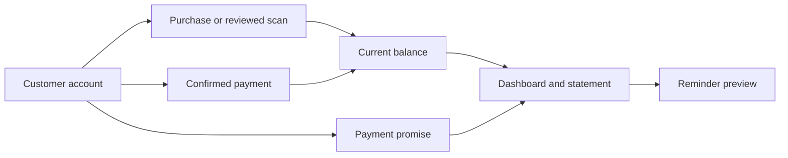

# Baakio

<strong>Know what's pending. Know who's next.</strong>

A customer credit ledger for everyday businesses.

  <a href="https://www.baakio.shop/">Website</a> ·
  <a href="https://www.baakio.shop/demo.html">Interactive demo</a> ·
  <a href="https://www.baakio.shop/app.html">Account app</a> ·
  <a href="https://github.com/sanjaygupta45/Baakio-be">Backend</a>

## The problem → the solution

| Everyday problem | Baakio's answer |
| --- | --- |
| Repeat purchases and partial payments make a notebook balance hard to trust. | One dated customer ledger with a current, server-calculated balance. |
| A promise to pay gets lost in calls or messages. | Due dates, overdue follow-ups, and a clear list of customers without a promise. |
| Handwritten bills take time to enter and can be misread. | AI prepares an editable draft; the owner checks it before posting. |
| A customer asks, “What is this amount for?” | A period statement and a reviewable WhatsApp reminder in English or Hindi. |

## Product flow

**The balance changes only when a purchase or confirmed payment is posted.** A promise is a plan; an AI scan is a draft until the owner approves it.

## Features

| Feature | What the owner can do |
| --- | --- |
| 📒 **Customer accounts** | Create and search customers; bring an existing balance into Baakio. |
| **Purchases** | Enter a quick amount or itemized bill, including quantities, prices, and discounts. |
| **Payments** | Record cash, UPI, or bank payments; track partial payments and apply them to promises. |
| 📅 **Promises and follow-ups** | Record due dates, reschedule with history, and see due, overdue, upcoming, or unpromised balances. |
| 📷 **AI bill scan** | Upload a bill, compare the original with extracted items, edit mistakes, and confirm the purchase. Manual entry remains available. |
| **Statements and reminders** | Review dated activity and period totals; prepare a short or detailed WhatsApp message with confirmed UPI details. |
| **Access and language** | Sign in by email code or configured Google sign-in; use the interface in English or Hindi. |

> **Try it:** The [interactive demo](https://www.baakio.shop/demo.html) uses fictional data and a simulated scan. The [account app](https://www.baakio.shop/app.html) saves records through the real API.

## Built with

| Layer | Technology |
| --- | --- |
| Client | React 19, TypeScript, Vite, i18next; mobile-first interface on Vercel. |
| API | Java 21, Spring Boot, MySQL, Flyway, RabbitMQ, private Cloud Storage, and Mistral OCR. |

The [backend README](https://github.com/sanjaygupta45/Baakio-be#readme) shows the scan architecture, ledger safeguards, and deployment pipeline.
